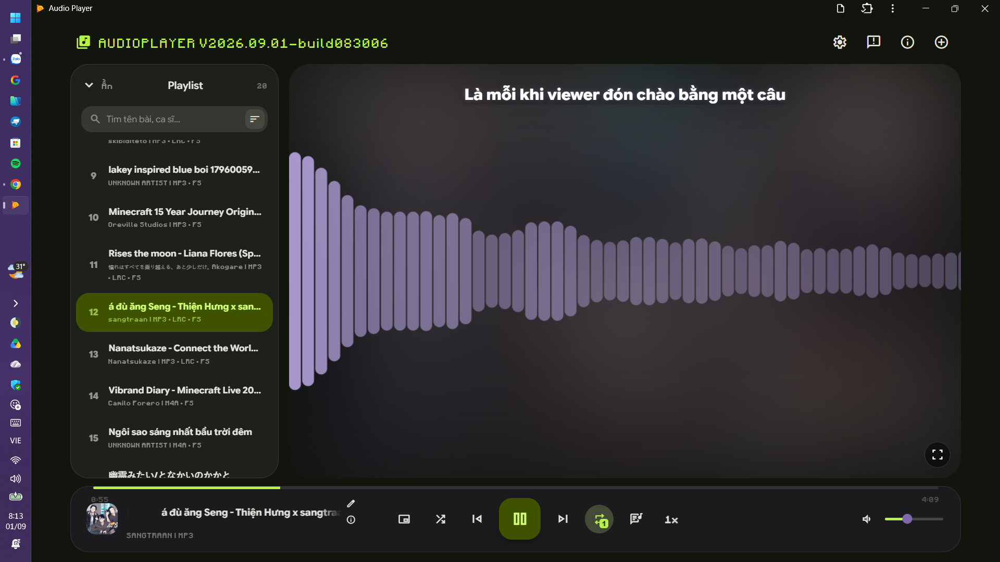
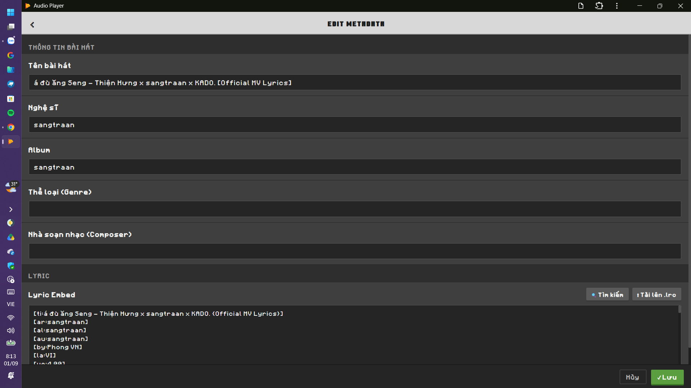
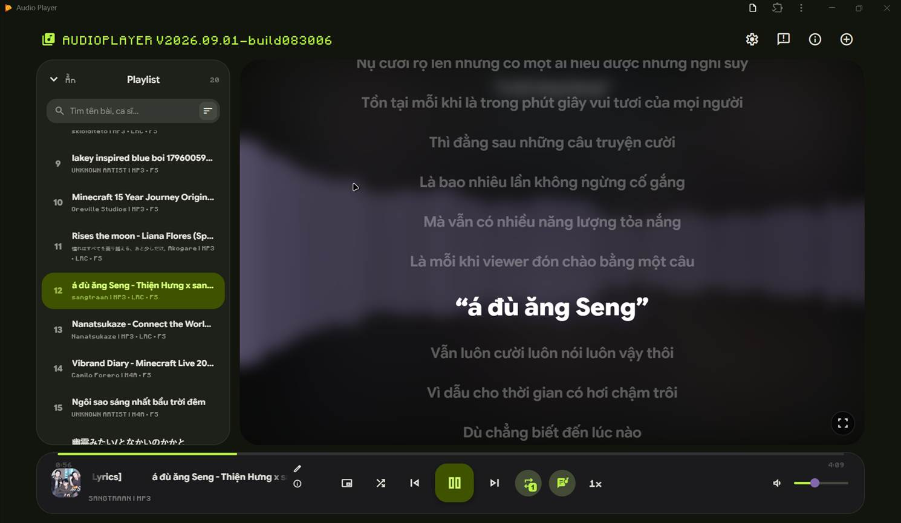

# 🎵 Media Player

> Một trình phát nhạc **và video** cục bộ (Client-side) hiện đại, mượt mà và giàu tính năng được xây dựng trên nền tảng giao diện **Material Design 3 Expressive**. Trải nghiệm nghe nhạc, xem video đỉnh cao ngay trên trình duyệt mà không cần cài đặt phần mềm phức tạp hay lo lắng về quyền riêng tư.

---

## 📸 Trải nghiệm

* 🌐 **Live App:** [Media Player](https://tuanphong3108.github.io/music-player/) *(Hoạt động 100% Offline sau khi tải xong)*

> ⚠️ **Yêu cầu tối thiểu:** trình duyệt nền Chromium (Chrome, Edge...) trên máy tính/laptop (kể cả máy cảm ứng như Surface), để dùng đầy đủ File System Access API và mở tệp trực tiếp bằng ứng dụng. Điện thoại không được hỗ trợ.

---

## Preview

---

## 🌟 Tính năng nổi bật

### 🎧 Trình phát & Quản lý danh sách
* **Hoàn toàn Cục bộ (100% Offline & Client-side):** Tất cả dữ liệu bài hát, video, metadata và lyrics được xử lý trực tiếp trên thiết bị của bạn, bảo mật tuyệt đối.
* **Kéo & Thả (Drag & Drop):** Thêm bài hát, video hoặc cả thư mục nhanh chóng chỉ bằng thao tác kéo thả.
* **Hỗ trợ PWA (Progressive Web App):** Cài đặt trực tiếp lên Windows/macOS/Linux như một ứng dụng độc lập, bấm đúp tệp nhạc/video để mở thẳng trong ứng dụng.
* **Bộ lọc & Tìm kiếm thông minh:** Tìm kiếm bài hát, nghệ sĩ, album, thể loại, nhà soạn nhạc siêu tốc với khả năng tự động bỏ qua dấu tiếng Việt và ký tự đặc biệt.
* **Shuffle thông minh:** Khi bật Shuffle, nút Previous lùi về bài trước trong 5 giây đầu, quá 5 giây thì tua về 0:00.

### 🎬 Phát video
* **Hỗ trợ video:** mp4, m4v, webm, mkv, mov, ogv, 3gp, avi (tuỳ codec mà trình duyệt giải mã được).
* **Hình hiện ngay trong khung chính** và cả ở Full Screen; ảnh bìa trong danh sách phát được chụp tự động từ một khung hình của video.
* **Full Screen cho video:** bấm một lần vào khung phát để ẩn thanh điều khiển và con trỏ, di chuột để hiện lại.
* **PiP cho video:** cửa sổ nổi theo đúng tỉ lệ khung video, nút điều khiển tự ẩn và hiện khi rê chuột vào; mở danh sách phát thì tạm thay khung video bằng ảnh bìa.
* **Subtitle Embed:** với video, trình chỉnh sửa chỉ còn khung phụ đề (LRC), lưu trong ứng dụng và tự áp dụng lại khi mở lại đúng tệp đó.

### 🎚️ Bộ trộn âm thanh (Audio Mixer)
* **Preamp** khuếch đại từ -12 đến +12 dB.
* **Equalizer 5 dải** với các cấu hình có sẵn (Phẳng, Bass mạnh, Treble sáng, Giọng hát nổi, Rock, Pop).
* **Cân bằng trái/phải**, **Mono** và **Chuẩn hoá âm lượng** (nén chênh lệch to nhỏ, hạn chế vỡ tiếng).
* **Sóng nhạc (Visualizer)** đổi màu theo Accent Color đang dùng.

### 📝 Trình chỉnh sửa Tag & Metadata MP3 mạnh mẽ
* **Chỉnh sửa trực tiếp:** Tên bài hát, Nghệ sĩ, Album, Thể loại, Nhà soạn nhạc và Lyric Embed.
* **Tìm lyric trên lrclib.net** ngay trong trình chỉnh sửa, có xem trước trước khi chèn; có thể điền các ô còn trống từ thẻ trong lyric (có hộp xác nhận và xem trước).
* **Quản lý Bìa đĩa (Cover Art):** Hỗ trợ xem, tải xuống, thay thế, cắt vuông (Crop) hoặc xoay ảnh bìa đĩa trực tiếp.
* **Ghi đè File thật:** Tích hợp *File System Access API* cho phép lưu và ghi đè trực tiếp thông tin vừa sửa vào file `.mp3` trên ổ cứng của bạn mà không cần tải lại file mới.

### 🎤 Đồng bộ Lời bài hát (Lyrics) & Chế độ xem
* **Karaoke Sync (LRC Format):** Đồng bộ và cuộn lời bài hát theo thời gian thực với hiệu ứng mượt mà; hiển thị cả thông tin người làm lyric và nguồn LRCLIB.
* **Picture-in-Picture (PiP):** Cửa sổ phát nổi có thanh trượt thời gian, danh sách phát và lyric, vừa làm việc khác vừa theo dõi bài hát/video.
* **Full Screen Mode:** Chế độ xem toàn màn hình tối giản, tập trung tối đa vào trải nghiệm âm nhạc và visualizer, giữ màn hình luôn sáng (Wake Lock).

### 🎨 Giao diện & Hiệu năng đỉnh cao
* **Material Design 3 Expressive:** Thiết kế hiện đại, màu sắc tự động linh hoạt (có thể lấy màu từ ảnh bìa), hiệu ứng tương tác (Ripple Effect, Overshoot Animation) cực bắt mắt.
* **Tuỳ biến:** Theme Tối/Sáng/Tự động, Accent Color, hơn 20 phông chữ (kèm phông Google Fonts / tệp riêng), thu phóng giao diện và cỡ chữ.
* **Đa ngôn ngữ:** Tiếng Việt và English.
* **Tối ưu máy cấu hình yếu:** Tùy chọn tắt/bật hiệu ứng chuyển động (*Reduce Motion*) và giảm độ mờ (*Blur Effect*) giúp ứng dụng mượt mà trên mọi thiết bị.

---

## ⌨️ Phím tắt điều khiển (Shortcuts)

| Phím tắt | Thao tác |
| :--- | :--- |
| **`Space`** | Tạm dừng / Tiếp tục phát |
| **`←` / `→`** | Tua lùi / Tua tiến 5 giây |
| **`Ctrl` + `←` / `→`** | Chuyển bài hát Trước / Tiếp theo |
| **`↑` / `↓`** | Tăng / Giảm 5% âm lượng |
| **`Ctrl` + `O`** | Mở hộp thoại chọn tệp nhạc/video từ máy tính |
| **`M`** | Tắt / Bật âm thanh (Mute / Unmute) |
| **`F11`** | Bật / Tắt chế độ Toàn màn hình (Full Screen) |

---

## 🛠️ Công nghệ sử dụng

* **UI Framework & Core:** HTML5, Tailwind CSS, Google Sans Flex Font.
* **Design System:** Material Web Components (`@material/web` - MD3 Expressive).
* **Metadata Processor:** `jsmediatags` (đọc ID3 tags) & `browser-id3-writer` (ghi & sửa ID3 tags).
* **Audio/Video Engine:** Web Audio API (bộ trộn âm thanh, visualizer) & HTML5 Media.

---

## 🚀 Hướng dẫn cài đặt

Không cần Node.js hay Build tool phức tạp, bạn có thể chạy dự án chỉ trong vài giây:
- Hãy truy cập [Media Player](https://tuanphong3108.github.io/music-player/)
- Tìm trên góc bên cạnh nút Settings để tìm nút Install
- Nhấn vào icon Install > Cài đặt
- Đã xong, bạn có thể trải nghiệm ngay lập tức

---

## 📝 Giấy phép (License)

Dự án này được phát hành dưới mã nguồn mở [MIT License](https://github.com/Tuanphong3108/music-player/blob/main/LICENSE).

### Dự án mã nguồn mở và miễn phí (FOSS)

Dự án này là dự án mã nguồn mở và miễn phí được làm bởi Phong VN, repo của dự án ở đây: [Media Player Repository](https://github.com/Tuanphong3108/music-player)

Build with ❤️ by [Phong VN](https://tuanphong3108.github.io).