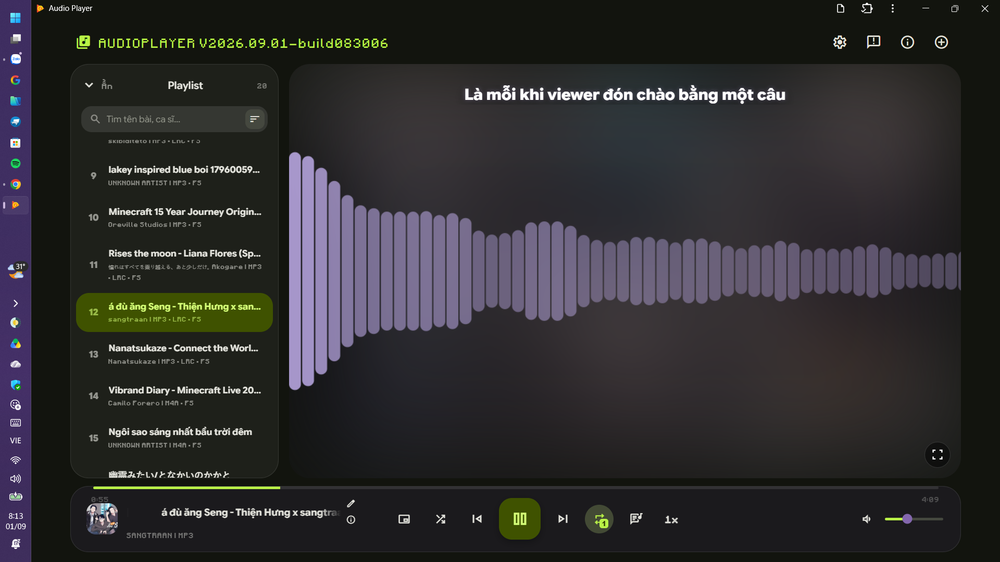
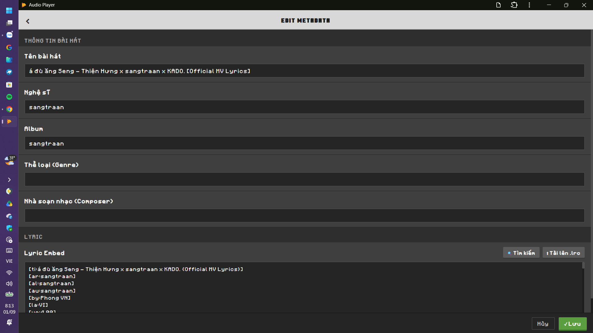
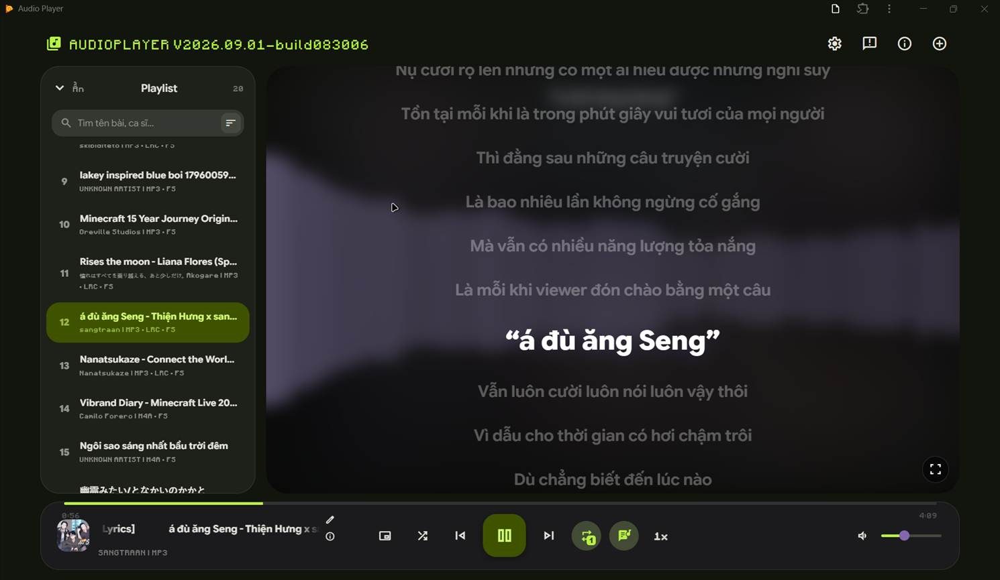

# 🎵 Media Player

> Trình phát nhạc **và video** cục bộ (Client-side & Hybrid Android) hiện đại, mượt mà và giàu tính năng được xây dựng trên nền tảng **Material Design 3 Expressive**. Hỗ trợ trải nghiệm trọn vẹn trên cả **máy tính (Web / PWA)** lẫn **điện thoại & máy tính bảng Android 8.0+ (APK gốc)**.

---

## 📸 Trải nghiệm & Tải xuống

* 🌐 **Web / PWA (Máy tính):** [tuanphong3108.github.io/music-player](https://tuanphong3108.github.io/music-player/) *(Hoạt động 100% Offline sau lần tải đầu)*
* 📱 **Ứng dụng Android (APK):** Tải `MediaPlayer.apk` mới nhất tại [GitHub Releases](https://github.com/Tuanphong3108/music-player/releases/) *(Yêu cầu Android 8.0 Oreo / API 26 trở lên)*

> 💡 **Khuyên dùng:**
> * **Trên PC / Laptop:** Dùng trình duyệt nền Chromium (Chrome, Edge, Brave...) và cài đặt thành **PWA** để dùng đầy đủ *File System Access API*, kéo-thả thư mục và mở tệp trực tiếp từ máy tính.
> * **Trên Điện thoại / Máy tính bảng Android:** Cài bản **APK chính thức** để có trình phát native Media3/ExoPlayer chạy nền độc lập, giao diện cảm ứng một tay, QuickPlay Bottom Sheet, 4 Widget màn hình chính và ghi đè thẻ ID3 trực tiếp vào bộ nhớ máy.

---

## 🖼️ Giao diện (Preview)

---

## 🌟 Tính năng nổi bật (Chung & Web / PWA)

### 🎧 Trình phát & Quản lý thư viện
* **100% Cục bộ & Bảo mật (Offline-first):** Toàn bộ tệp nhạc, video, ảnh bìa và lời bài hát được xử lý trực tiếp trên thiết bị, không tải dữ liệu cá nhân lên máy chủ.
* **Thư viện thông minh:** Phân chia rõ ràng tab **Bài hát**, **Danh sách phát (Custom Playlists)**, **Bài hát đã thích (Liked Songs)** và **Hàng đợi phát** (hỗ trợ kéo-thả sắp xếp thứ tự).
* **Tìm kiếm & Lọc siêu tốc:** Tìm theo tên bài, nghệ sĩ, album, thể loại, nhà soạn nhạc; tự động bỏ qua dấu tiếng Việt và ký tự đặc biệt, có nút định vị nhanh tới bài đang phát.
* **Điều khiển phát linh hoạt:**
  * **Shuffle thông minh:** Khi bật Trộn bài, bấm *Previous* trong 5 giây đầu sẽ lùi về bài trước, quá 5 giây sẽ tua về `0:00`.
  * **Tốc độ phát (Playback Speed)** tùy chỉnh mượt mà.
  * **Hẹn giờ ngủ (Sleep Timer):** Tự động tạm dừng nhạc sau số phút tùy chọn hoặc sau `N` bài hát (kèm thông báo nhắc khi hoàn thành).
  * **Chọn thiết bị đầu ra âm thanh:** Chuyển đổi nhanh giữa loa ngoài, tai nghe có dây và tai nghe Bluetooth.

### 🎬 Phát Video (Bản Web / PC)
* **Đa định dạng:** Hỗ trợ `mp4`, `m4v`, `webm`, `mkv`, `mov`, `ogv`, `3gp`, `avi` (tùy codec trình duyệt hỗ trợ); tự động chụp khung hình làm ảnh bìa trong danh sách.
* **Full Screen & PiP thông minh:** Cửa sổ nổi Picture-in-Picture tự co theo đúng tỉ lệ khung hình video, tự ẩn điều khiển khi không rê chuột và tạm đổi sang ảnh bìa khi mở danh sách phát.
* **Phụ đề nhúng (LRC Subtitle):** Lưu và tự động áp dụng lại phụ đề `.lrc` cho từng tệp video.

### 🎚️ Bộ trộn âm thanh (Audio Mixer) & Visualizer
* **Preamp:** Khuếch đại từ `-12 dB` đến `+12 dB`.
* **Equalizer 5 dải (`60Hz`, `230Hz`, `910Hz`, `3.6kHz`, `14kHz`):** Tích hợp sẵn các preset (*Phẳng, Bass mạnh, Treble sáng, Giọng hát nổi, Rock, Pop*).
* **Xử lý tín hiệu nâng cao:** **Cân bằng trái/phải (Balance)**, **Chế độ Mono** và **Chuẩn hóa âm lượng (Compressor)** giúp cân bằng âm lượng giữa các bài và hạn chế vỡ tiếng.
* **Sóng nhạc (Visualizer):** Phân tích phổ thời gian thực và đổi màu đồng bộ theo Accent Color.

### 📝 Trình chỉnh sửa Tag & Metadata mạnh mẽ
* **Đọc & Ghi đa định dạng:** Hỗ trợ đọc tag từ `MP3`, `FLAC`, `M4A`, `OGG`, `OPUS`, `WAV`... và chỉnh sửa trực tiếp **Tên bài hát, Nghệ sĩ, Album, Năm, Thể loại, Nhà soạn nhạc, Lyric Embed**.
* **Tích hợp LRCLIB (`lrclib.net`):** Tìm kiếm lời bài hát đồng bộ ngay trong trình chỉnh sửa, xem trước trước khi chèn và tự động điền các trường metadata còn trống từ thẻ trong lyric.
* **Quản lý Bìa đĩa (Cover Art):** Xem, tải xuống, thay ảnh mới, cắt vuông (Crop) hoặc xoay ảnh bìa trực tiếp.
* **Ghi đè File gốc:** Lưu trực tiếp thông tin vừa sửa vào tệp thật trên ổ cứng (qua *File System Access API* trên PC hoặc quyền truy cập tệp trên Android) mà không cần tải bản sao mới.

### 🎤 Lời bài hát đồng bộ (Lyrics) & 🤖 AI Playlist
* **Karaoke Sync (`.lrc`):** Cuộn lời theo thời gian thực mượt mà, hiển thị tác giả lyric và nguồn LRCLIB; tự động quét tệp `.lrc` cùng thư mục.
* **AI Integration (β):** Tạo danh sách phát thông minh bằng AI dựa trên thư viện nhạc hiện có trên máy (tùy chọn nhà cung cấp AI, API Key, model và prompt).

### 🎨 Giao diện MD3 Expressive & Tối ưu hiệu năng
* **Material Design 3 Expressive:** Thanh tua dạng sóng chuyển động (*Wavy Progress*), hiệu ứng *Overshoot / Spring*, phông chữ **Google Sans Flex** biến thiên (kèm phông Minecraft cho các chi tiết kỹ thuật).
* **Cá nhân hóa sâu:** Giao diện Sáng / Tối / Theo hệ thống, 10 bảng màu Accent hoặc **tự lấy màu động từ Album Art**, tùy chỉnh thu phóng giao diện và cỡ chữ, hỗ trợ **Tiếng Việt & English**.
* **Tối ưu máy cấu hình yếu:** 4 mức cấu hình sẵn (*Đầy đủ / Cân bằng / Tiết kiệm / Hiệu năng tối đa*) và công tắc tắt/bật riêng cho hiệu ứng chuyển động, kính mờ (`backdrop-filter`), nền mờ ảnh bìa và sóng nhạc.

---

## 📱 Tính năng độc quyền trên bản Android (Native + WebView)

Bản Android không chỉ là một khung WebView đơn thuần mà kết hợp trực tiếp với tầng **Android Native (Media3 / ExoPlayer)** để đạt hiệu năng và trải nghiệm như ứng dụng thuần:

* **Trình phát Native chạy nền độc lập (`NativeAudio` + `MediaService`):**
  * Nhạc chạy trực tiếp qua **Media3 ExoPlayer** trên luồng ưu tiên âm thanh riêng — không bị giật, không bị Android đóng băng khi tắt màn hình hay khi WebView tạm nghỉ.
  * Tích hợp sẵn **DSP MixerProcessor** chạy trực tiếp trong chuỗi âm thanh native (EQ 5 dải, Preamp, Mono, Compressor, Balance và phổ FFT 128 dải đồng bộ lên giao diện).
  * Tự động dựng bảng chỉ mục tua (**WebM/MKV Cue Indexer**) cho các tệp thiếu metadata tua mà không làm giảm chất lượng âm thanh.
  * Tự động phục hồi phiên phát, hàng đợi, chế độ Shuffle/Repeat và tự động dọn dẹp an toàn nếu tiến trình gặp sự cố.
* **Sheet phát nhanh (`QuickPlayActivity`):**
  * Khi bấm mở tệp âm thanh từ trình quản lý tệp hoặc ứng dụng khác, một **Bottom Sheet nổi** hiện lên gần như tức thì (không cần chờ nạp WebView).
  * Tự động đổi màu theo Album Art, có thanh tua dạng sóng, hỗ trợ **2 tab Tùy chọn / Thông tin** đầy đủ và hiệu ứng phóng to chuyển mượt vào thẳng **Full Player** của ứng dụng chính.
* **Hệ thống 4 Widget màn hình chính:**
  * **3 Widget trình phát:** Tự co giãn (`4×2`), Vuông tối giản (`2×2`), và Đầy đủ điều khiển (`4×2` có cả Shuffle & Repeat).
  * **Queue Widget:** Hiển thị danh sách các bài sắp phát tiếp theo và cho phép bấm chọn phát ngay từ màn hình chính.
  * Đồng bộ màu nền, màu chữ và màu nút theo **Material You** hoặc màu động của bài hát đang phát (Android 12+).
* **Giao diện Mobile & Tablet tối ưu:**
  * Bố cục cảm ứng một tay với **Mini Player dạng viên thuốc** (vuốt ngang để dừng và ẩn, chạm để mở rộng Full Player), màn hình chính thư viện riêng và chia **2 cột song song** trên máy tính bảng màn hình ngang.
  * Hỗ trợ đầy đủ cử chỉ **Predictive Back** (Android 13/14+) và hiển thị tràn viền **Edge-to-Edge** (Android 15/16).
* **Tiện ích hệ thống & Cập nhật trong app:**
  * Quét toàn bộ nhạc trên thiết bị qua MediaStore, hỗ trợ **loại trừ thư mục**, đọc lyric nhúng đa định dạng (`ID3v2`, `MP4/M4A`, `Vorbis Comment`), đặt bài hát làm **Nhạc chuông / Âm thông báo / Âm báo thức**, chia sẻ nhiều tệp cùng lúc và **tự động kiểm tra & tải cập nhật APK** trực tiếp từ GitHub Releases.
  * **Developer Features:** Bật công tắc để mở cửa sổ **Native Console** vuông ngay nửa dưới màn hình (đẩy WebView lên trên), bắt log JS, chạy lệnh trực tiếp, soi lớp phủ giao diện và xem logcat của ứng dụng.

---

## ⌨️ Phím tắt điều khiển (Trên máy tính)

| Phím tắt | Thao tác |
| :--- | :--- |
| **`Space`** | Tạm dừng / Tiếp tục phát |
| **`←` / `→`** | Tua lùi / Tua tiến 5 giây |
| **`Ctrl` + `←` / `→`** | Chuyển bài hát Trước / Tiếp theo |
| **`↑` / `↓`** | Tăng / Giảm 5% âm lượng |
| **`Ctrl` + `O`** | Mở hộp thoại chọn tệp nhạc/video từ máy tính |
| **`M`** | Tắt / Bật âm thanh (Mute / Unmute) |
| **`F11`** | Bật / Tắt chế độ Toàn màn hình (Full Screen) |

---

## 🛠️ Công nghệ sử dụng

* **Giao diện & Web Core:** HTML5, CSS3, Tailwind CSS, Material Web Components (`@material/web` — MD3 Expressive), Google Sans Flex.
* **Xử lý Metadata & Lyrics:** `jsmediatags`, `browser-id3-writer`, LRCLIB API, plus native Java embedded lyrics parser and WebM cue indexer.
* **Audio Engine:** Web Audio API (trên Web/PC) & **AndroidX Media3 ExoPlayer 1.4.1** kèm custom `AudioProcessor` DSP (trên Android).
* **Nền tảng Android:** Java 17, `compileSdk 36`, `targetSdk 36`, `minSdk 26` (Android 8.0+), AndroidX Core & WebKit, tự động build & phát hành APK qua GitHub Actions.

---

## 🚀 Hướng dẫn cài đặt

### 1. Trên máy tính (PWA)
1. Truy cập [Media Player](https://tuanphong3108.github.io/music-player/) bằng Chrome hoặc Edge.
2. Nhấn vào biểu tượng **Cài đặt (Install)** trên thanh địa chỉ hoặc cạnh nút Cài đặt ở góc trên bên phải.
3. Xác nhận **Cài đặt** để sử dụng như ứng dụng độc lập và hoạt động hoàn toàn ngoại tuyến.

### 2. Trên Android (APK)
1. Tải tệp `MediaPlayer.apk` mới nhất từ trang [Releases](https://github.com/Tuanphong3108/music-player/releases/).
2. Mở tệp APK để cài đặt (cho phép cài đặt từ nguồn này nếu hệ thống yêu cầu).
3. Mở ứng dụng và cấp quyền truy cập âm thanh / hình ảnh / tệp tin theo hướng dẫn khởi đầu.

---

## 📝 Giấy phép (License)

Dự án được phát hành dưới giấy phép mã nguồn mở [MIT License](https://github.com/Tuanphong3108/music-player/blob/main/LICENSE).

Phát triển với ❤️ bởi **[Phong VN](https://tuanphong3108.github.io)** — [Tuanphong3108/music-player](https://github.com/Tuanphong3108/music-player).
