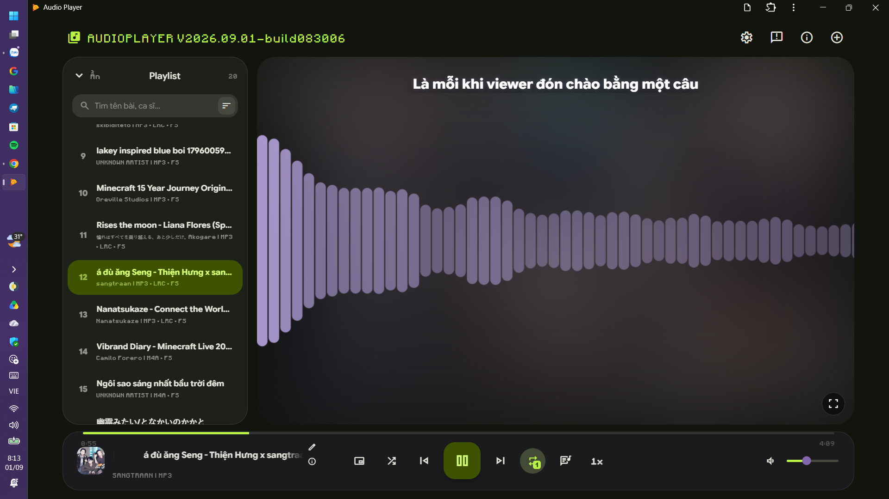
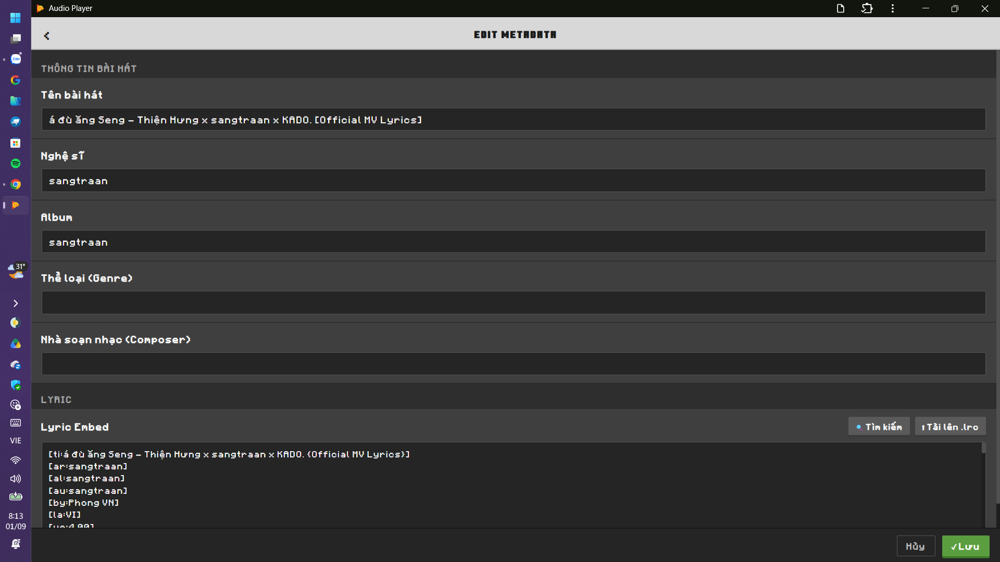
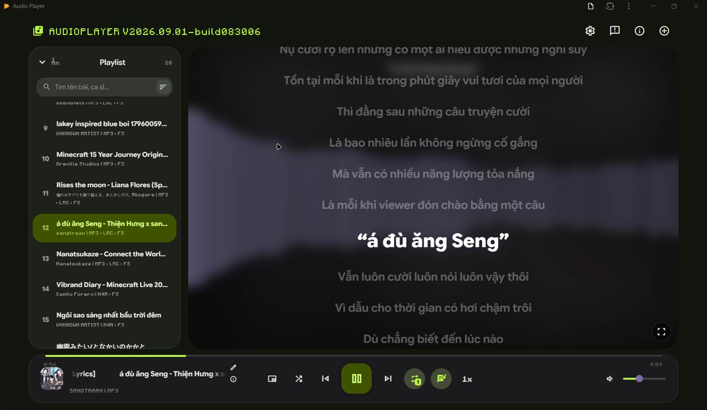

# 🎵 Media Player

> A modern, smooth, and feature-rich local (client-side) **audio and video** player built on top of **Material Design 3 Expressive**. Experience high-quality music and video playback directly in your browser without complex software installation or privacy concerns.

---

## 📸 Experience

* 🌐 **Live App:** [Media Player](https://tuanphong3108.github.io/music-player/) *(Works 100% Offline after loading)*

> ⚠️ **Minimum requirement:** a Chromium-based browser (Chrome, Edge...) on a desktop/laptop PC (touch PCs such as Surface are fine), so the File System Access API and opening files directly in the app work fully. Phones are not supported.

---

## Preview

---

## 🌟 Key Features

### 🎧 Player & Playlist Management
* **100% Offline & Client-side:** All tracks, videos, metadata, and lyrics are processed directly on your device, ensuring maximum privacy.
* **Drag & Drop:** Quickly add tracks, videos, or entire folders with simple drag-and-drop actions.
* **PWA Support (Progressive Web App):** Install directly onto Windows, macOS, or Linux as a standalone app; double-click a music/video file to open it straight in the app.
* **Smart Filter & Search:** Lightning-fast searching across songs, artists, albums, genres, and composers with automatic diacritics and special character stripping.
* **Smart Shuffle:** With Shuffle on, Previous goes back to the previous track within the first 5 seconds, and restarts the song at 0:00 after that.

### 🎬 Video Playback
* **Video support:** mp4, m4v, webm, mkv, mov, ogv, 3gp, avi (depending on the codecs your browser can decode).
* **Picture right in the main stage** and in Full Screen; playlist thumbnails are captured automatically from a video frame.
* **Full Screen for video:** click once on the picture to hide the control bar and cursor, move the mouse to bring them back.
* **PiP for video:** the floating window follows the video's aspect ratio, controls auto-hide and reappear on hover; opening the playlist temporarily swaps the video for the cover.
* **Subtitle Embed:** for videos, the editor shows only the subtitle (LRC) box, saved inside the app and re-applied whenever you open the same file.

### 🎚️ Audio Mixer
* **Preamp** from -12 to +12 dB.
* **5-band Equalizer** with presets (Flat, Bass boost, Bright treble, Vocal boost, Rock, Pop).
* **Left/right balance**, **Mono**, and **Volume normalization** (squeezes loud/quiet gaps and helps prevent distortion).
* **Visualizer** follows your current Accent Color.

### 📝 Powerful MP3 Tag & Metadata Editor
* **Direct Editing:** Song Title, Artist, Album, Genre, Composer, and Lyric Embed.
* **Search lyrics on lrclib.net** right inside the editor, with a preview before inserting; empty fields can be filled from the lyric's tags (with a confirmation and preview).
* **Cover Art Management:** View, download, replace, crop to square, or rotate album artwork directly.
* **Real File Overwriting:** Integrated with the *File System Access API* to save and overwrite updated ID3 tags directly back to `.mp3` files on your storage without downloading new copies.

### 🎤 Synchronized Lyrics & View Modes
* **Karaoke Sync (LRC Format):** Real-time lyric synchronization and auto-scrolling with smooth visual effects; shows the lyric author and LRCLIB credit.
* **Picture-in-Picture (PiP):** Floating media window with a time slider, playlist, and lyrics to monitor playback/video while working in other apps.
* **Full Screen Mode:** Minimalist full-screen view designed to keep your focus on the music and visualizer, with the screen kept awake (Wake Lock).

### 🎨 Design & Performance Optimized
* **Material Design 3 Expressive:** Modern aesthetics featuring dynamic colors (optionally taken from the cover art), rich interactions (Ripple Effects, Overshoot Animations).
* **Customization:** Dark/Light/System theme, Accent Color, 20+ fonts (plus Google Fonts / your own files), UI scale and font scale.
* **Multilingual:** Vietnamese and English.
* **Low-end Device Optimization:** Options to toggle motion effects (*Reduce Motion*) and disable background blurs (*Blur Effect*) for fluid performance across all hardware.

---

## ⌨️ Keyboard Shortcuts

| Shortcut | Action |
| :--- | :--- |
| **`Space`** | Play / Pause playback |
| **`←` / `→`** | Seek backward / forward 5 seconds |
| **`Ctrl` + `←` / `→`** | Previous / Next track |
| **`↑` / `↓`** | Volume Up / Down by 5% |
| **`Ctrl` + `O`** | Open the music/video file picker |
| **`M`** | Mute / Unmute audio |
| **`F11`** | Toggle Full Screen mode |

---

## 🛠️ Built With

* **UI Framework & Core:** HTML5, Tailwind CSS, Google Sans Flex Font.
* **Design System:** Material Web Components (`@material/web` - MD3 Expressive).
* **Metadata Processor:** `jsmediatags` (read ID3 tags) & `browser-id3-writer` (write & edit ID3 tags).
* **Audio/Video Engine:** Web Audio API (mixer, visualizer) & HTML5 Media.

---

## 🚀 Installation Guide

No Node.js or complex build tools required! You can run and install the app in seconds:
- Visit [Media Player](https://tuanphong3108.github.io/music-player/)
- Look next to the Settings button in the top bar for the Install icon
- Click the **Install** icon > Confirm Install
- Done! You can now use it natively offline.

---

## 📝 License

Distributed under the [MIT License](https://github.com/Tuanphong3108/music-player/blob/main/LICENSE).

### Free and Open-Source Software (FOSS) Project

This is a free and open-source project created by Phong VN. Check out the project repository here: [Media Player Repository](https://github.com/Tuanphong3108/music-player)

Built with ❤️ by [Phong VN](https://tuanphong3108.github.io).