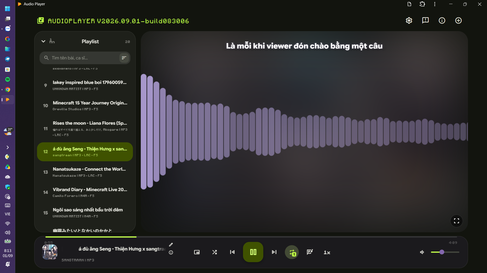
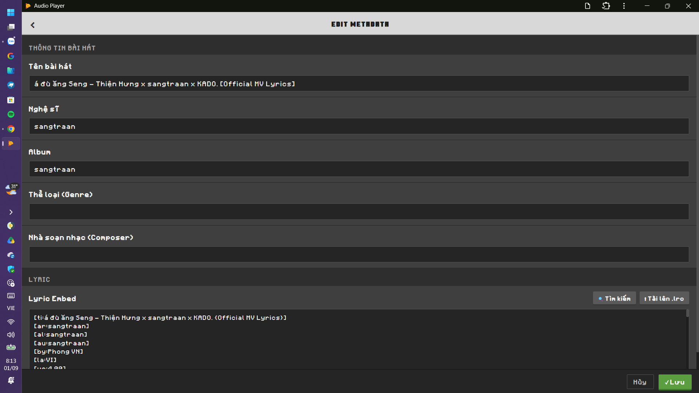
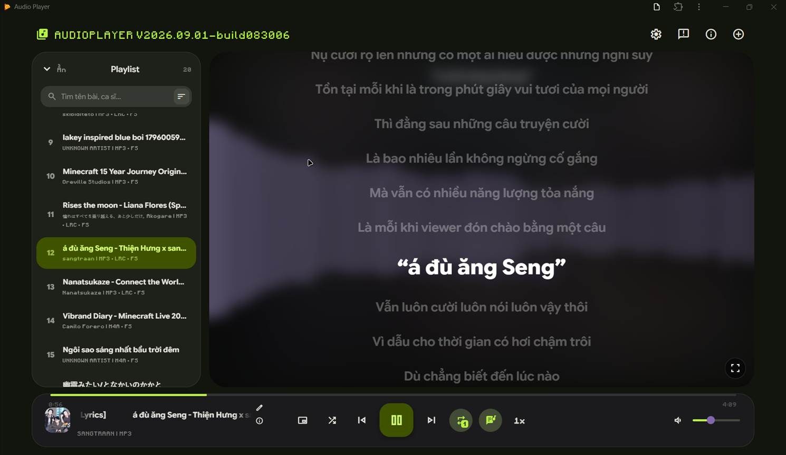

# 🎵 Media Player

[🇻🇳 Tiếng Việt](README.md) | 🌐 **English**

> A modern, smooth, and feature-rich local (client-side & hybrid Android) **audio and video** player built on top of **Material Design 3 Expressive**. Engineered for a seamless experience across both **desktop browsers (Web / PWA)** and **Android 8.0+ phones & tablets (native APK)**.

---

## 📸 Experience & Downloads

* 🌐 **Web / PWA (Desktop):** [tuanphong3108.github.io/music-player](https://tuanphong3108.github.io/music-player/) *(Works 100% offline after initial load)*
* 📱 **Android App (APK):** Download the latest `MediaPlayer.apk` from [GitHub Releases](https://github.com/Tuanphong3108/music-player/releases/) *(Requires Android 8.0 Oreo / API 26 or higher)*

> 💡 **Recommended setups:**
> * **On PC / Laptop:** Use a Chromium-based browser (Chrome, Edge, Brave...) and install it as a **PWA** for full *File System Access API* support, folder drag-and-drop, and direct file opening from your OS.
> * **On Android Phones & Tablets:** Install the **official Android APK** for background playback powered by native Media3/ExoPlayer, one-handed touch layouts, the QuickPlay bottom sheet, 4 home-screen widgets, and direct ID3 tag overwriting on device storage.

---

## 🖼️ Preview

---

## 🌟 Key Features (Shared & Web / PWA)

### 🎧 Player & Library Management
* **100% Local & Private (Offline-first):** All tracks, videos, cover artwork, and lyrics are processed directly on your device—nothing is uploaded to external servers.
* **Smart Library Organization:** Dedicated views for **Songs**, **Custom Playlists**, **Liked Songs**, and the **Active Queue** (with drag-and-drop reordering).
* **Fast Search & Filtering:** Search across titles, artists, albums, genres, and composers with automatic diacritics and special-character stripping, plus a one-tap locate button to jump straight to the active track.
* **Flexible Playback Controls:**
  * **Smart Shuffle:** With Shuffle enabled, pressing *Previous* within the first 5 seconds goes back to the previous track; after 5 seconds, it restarts at `0:00`.
  * **Adjustable Playback Speed** with smooth transitions.
  * **Sleep Timer:** Automatically pause playback after a custom number of minutes or after `N` tracks (with a completion alert).
  * **Audio Output Switcher:** Switch between built-in speaker, wired headphones, and Bluetooth audio devices.

### 🎬 Video Playback (Web / Desktop)
* **Broad Format Support:** Plays `mp4`, `m4v`, `webm`, `mkv`, `mov`, `ogv`, `3gp`, and `avi` (depending on browser codec support), automatically capturing a video frame for playlist thumbnails.
* **Immersive Full Screen & PiP:** Picture-in-Picture floating window matches the video aspect ratio, auto-hides controls when idle, and swaps to cover art while browsing the playlist.
* **Embedded Subtitles (LRC):** Saves and automatically reapplies `.lrc` subtitles whenever you reopen the same video file.

### 🎚️ Audio Mixer & Visualizer
* **Preamp:** Gain boost/cut from `-12 dB` to `+12 dB`.
* **5-Band Equalizer (`60Hz`, `230Hz`, `910Hz`, `3.6kHz`, `14kHz`):** Includes built-in presets (*Flat, Bass Boost, Bright Treble, Vocal Boost, Rock, Pop*).
* **DSP Enhancements:** **Left/Right Balance**, **Mono downmix**, and **Volume Normalization (Compressor)** to even out loudness differences and prevent clipping.
* **Audio Visualizer:** Real-time spectrum visualization styled dynamically with your active Accent Color.

### 📝 Powerful Tag & Metadata Editor
* **Multi-Format Read & Write:** Reads tags from `MP3`, `FLAC`, `M4A`, `OGG`, `OPUS`, `WAV`, and more; edits **Title, Artist, Album, Year, Genre, Composer, and Embedded Lyrics**.
* **Built-in LRCLIB (`lrclib.net`) Search:** Search synchronized lyrics directly inside the editor, preview before inserting, and auto-fill missing metadata fields from lyric tags.
* **Cover Art Management:** View, download, replace, crop to square, or rotate album artwork directly.
* **Direct File Overwriting:** Writes updated ID3 tags straight back into the original file on disk (via *File System Access API* on desktop or native storage permissions on Android) without creating duplicate downloads.

### 🎤 Synchronized Lyrics & 🤖 AI Playlist
* **Karaoke Sync (`.lrc`):** Smooth real-time scrolling lyrics displaying lyricist and LRCLIB credits, plus automatic `.lrc` matching from the same folder.
* **AI Integration (β):** Generate smart playlists from your local music library using AI (configurable AI provider, API key, model, and custom prompt).

### 🎨 MD3 Expressive UI & Performance Tuning
* **Material Design 3 Expressive:** Animated wavy seek progress bar, *Overshoot / Spring* physics, and variable **Google Sans Flex** typography (paired with Minecraft font accents for technical readouts).
* **Deep Customization:** Light / Dark / System themes, 10 Accent Color palettes or **dynamic color extraction from Album Art**, adjustable UI & font scaling, and **English / Vietnamese** localization.
* **Low-End Hardware Optimization:** 4 performance presets (*Full / Balanced / Power Saver / Maximum Performance*) plus individual toggles for animations, frosted glass (`backdrop-filter`), blurred cover backdrop, and the visualizer.

---

## 📱 Exclusive Android App Features (Native + WebView)

Rather than a basic WebView wrapper, the Android edition pairs the web interface directly with a **native Android Media3 / ExoPlayer engine** for true native reliability and responsiveness:

* **Independent Native Background Playback (`NativeAudio` + `MediaService`):**
  * Audio plays directly through **Media3 ExoPlayer** on a dedicated high-priority audio thread—eliminating stutters and preventing Android from freezing playback when the screen turns off or the WebView sleeps.
  * Built-in native **DSP `MixerProcessor`** running inside the ExoPlayer audio pipeline (5-band EQ, Preamp, Mono, Compressor, Balance, and 128-band FFT spectrum streaming back to the UI).
  * Automatic **WebM/MKV Cue Indexer** that builds seek tables on the fly for files missing cue metadata without re-encoding or losing audio quality.
  * Automatic session/queue/shuffle/repeat persistence and clean recovery if the background process is reclaimed by the OS.
* **QuickPlay Bottom Sheet (`QuickPlayActivity`):**
  * Opening an audio file from any file manager or external app launches a **floating Bottom Sheet** near-instantly (without waiting for WebView initialization).
  * Dynamically adapts its palette to the track's Album Art, features a wavy seek bar, provides full **OPTIONS / INFO** tabs, and smoothly expands into the main app's **Full Player**.
* **4 Home-Screen Widgets:**
  * **3 Media Player Widgets:** Responsive (`4×2`), Compact Square (`2×2`), and Full Controls (`4×2` with Shuffle & Repeat toggles).
  * **Queue Widget:** Displays upcoming tracks in the queue and lets you tap any track to play immediately from the home screen.
  * Automatically tinted to match **Material You** or the current track's dynamic colors (Android 12+).
* **Mobile & Tablet Adaptive Layouts:**
  * One-handed mobile layout with a floating **pill Mini Player** (swipe horizontally to stop and dismiss, tap to expand to Full Player), a dedicated mobile library home screen, and a **two-column split layout** on landscape tablets.
  * Full support for **Predictive Back** gestures (Android 13/14+) and **Edge-to-Edge** display insets (Android 15/16).
* **System Utilities & In-App Updates:**
  * Scans device audio via MediaStore with **folder exclusion**, reads embedded lyrics across `ID3v2`, `MP4/M4A`, and `Vorbis Comment`, sets tracks as **Ringtone / Notification / Alarm**, shares multiple files at once, and **checks/downloads APK updates** directly from GitHub Releases.
  * **Developer Features:** Toggleable docked **Native Console** window at the bottom of the screen (pushing the WebView upward) to capture JS logs, run commands, inspect touch layers, and view app logcat output.

---

## ⌨️ Keyboard Shortcuts (Desktop)

| Shortcut | Action |
| :--- | :--- |
| **`Space`** | Play / Pause playback |
| **`←` / `→`** | Seek backward / forward 5 seconds |
| **`Ctrl` + `←` / `→`** | Previous / Next track |
| **`↑` / `↓`** | Increase / Decrease volume by 5% |
| **`Ctrl` + `O`** | Open music/video file picker |
| **`M`** | Mute / Unmute audio |
| **`F11`** | Toggle Full Screen mode |

---

## 🛠️ Tech Stack

* **Frontend & Design System:** HTML5, CSS3, Tailwind CSS, Material Web Components (`@material/web` — MD3 Expressive), Google Sans Flex.
* **Metadata & Lyrics:** `jsmediatags`, `browser-id3-writer`, LRCLIB API, plus native Java embedded lyrics parser and WebM cue indexer.
* **Audio Engine:** Web Audio API (Web/Desktop) & **AndroidX Media3 ExoPlayer 1.4.1** with custom DSP `AudioProcessor` (Android).
* **Android Platform:** Java 17, `compileSdk 36`, `targetSdk 36`, `minSdk 26` (Android 8.0+), AndroidX Core & WebKit, automated APK builds via GitHub Actions.

---

## 🚀 Installation Guide

### 1. Desktop (PWA)
1. Open [Media Player](https://tuanphong3108.github.io/music-player/) in Chrome or Edge.
2. Click the **Install** icon in the address bar or next to the Settings button in the top-right corner.
3. Confirm **Install** to run it as a standalone offline-ready desktop app.

### 2. Android (APK)
1. Download the latest `MediaPlayer.apk` from the [Releases](https://github.com/Tuanphong3108/music-player/releases/) page.
2. Open the downloaded APK and allow installation from this source if prompted.
3. Launch the app and grant audio/media file permissions during the initial setup guide.

---

## 📝 License

Distributed under the open-source [MIT License](https://github.com/Tuanphong3108/music-player/blob/main/LICENSE).

Built with ❤️ by **[Phong VN](https://tuanphong3108.github.io)** — [Tuanphong3108/music-player](https://github.com/Tuanphong3108/music-player).
